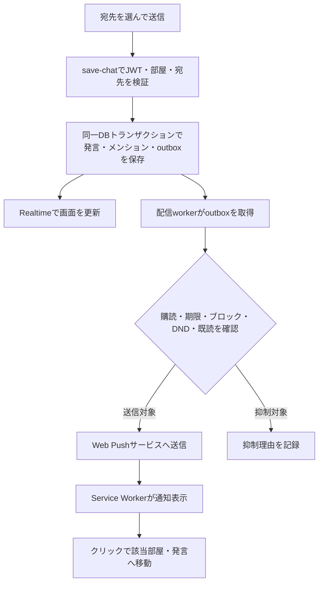

# チャット体験の新機能企画・実装計画

作成日: 2026-09-23  
更新日: 2026-10-12（現行構成の反映・リファクタリング計画の独立化）  
状態: 検討案。機能の実装・本番設定の変更は未実施。

現行インタラクションのリファクタリング方針は別文書の[HTML・CSSネイティブインタラクションのリファクタリング計画](INTERACTION_REFACTORING_PLAN.md)で管理する。2章の受信・発言保存・metadata、4章の接続先、6〜8章の冪等化・削除権限の前提は追記日に現行コードへ更新した。機能企画の秒数・件数・工数は提案値として扱う。

## 1. 提案の要点

「呼ばれたら気づく」「新しい発言が自然に目に入る」「相手の状態が分かる」を中心に、登録不要・レトロな見た目を保ったまま、会話の続けやすさを改善する。

まず **新着フェードインと未読位置の保持**を導入し、次に**匿名の利用者識別・離席表示・画面内メンション**、最後に**Web Push通知**へ進む。通知だけを先に作ると、同名ユーザーへの誤通知、離席と切断の混同、連続通知の問題が残るため、宛先と通知制御を先に固める。

画像貼り付けも追加候補とする。**Supabase Storageで小規模に試し、閲覧量が増える場合はCloudflare R2へ切り替えられる構成**を推奨する。匿名識別と画像の検証・削除・通報を前提とし、Web Pushとは独立して段階導入できる。無料枠の比較、容量試算、公開条件はF11にまとめる。

ユーザー体験の例:

1. 入室した人が「会話OK」「読むだけ」を選ぶ。
2. 新しい発言がログ上部へ短くフェードインする。過去ログを読んでいれば「新着3件」が出る。
3. 別のタブで作業を始めると、しばらくして「離席中」になる。
4. 相手が参加者を選んでメンションし、受信側が通知を有効にしていればWeb Pushで気づく。
5. 通知から戻ると、自分宛ての発言と「離席中の新着12件」を確認できる。

目的は通知数や滞在時間を増やすことではなく、呼びかけへの返信と会話再開を増やすこと。[成長戦略](GROWTH_STRATEGY.md)の会話成立・再訪支援を具体化する企画として扱う。

## 2. 現行実装から分かったこと

以下は作成日時点の作業ツリーで確認した事実（受信・発言保存・metadataの行は2026-10-12に更新）。本番DBへのmigration適用状況、実利用者数、端末比率、課金プランは未確認。以降の閾値・工数・目標値は提案値である。

| 領域            | 現状と根拠                                                                                                                                                                                                         | 計画への影響                                                                                     |
| --------------- | ------------------------------------------------------------------------------------------------------------------------------------------------------------------------------------------------------------------ | ------------------------------------------------------------------------------------------------ |
| 配信構成        | React / TypeScript / Vite、GitHub Pages、Supabase。詳細は[README](../README.md)                                                                                                                                    | Push送信はEdge側に置く。静的ホスティングの移行は不要                                             |
| ログ表示        | [ChatLogList](../src/features/chat/components/ChatLogList/index.tsx)は新しい順・表示件数制限・UUIDをReact keyに使用                                                                                                | 新着を上から出す動きが自然。単純なmount時アニメーションでは既存行まで再生される                  |
| 受信            | [Room_Log_Store](../src/features/chat/api/roomLogStore.ts)がRealtime・snapshot・再取得を統合し、[useRoomLog](../src/features/chat/hooks/useRoomLog.ts)が楽観的更新を重ねる                                         | 受信経路を区別し、初期取得と再取得を「新着演出」に含めない                                       |
| 全部屋・Chanari | 全部屋は同じstore実装の別LogSource、Chanariは部屋storeと共通ChatLogListを利用。専用UIは上段のみ                                                                                                                    | 共通ロジックと各画面のスクロール枠・副作用の差を分けて検証する                                   |
| 参加者          | [useParticipants](../src/features/chat/hooks/useParticipants.ts)は直近5分の発言・入退室文を名前で集約。`Participant.uuid`は発言UUID                                                                                | 現在接続中かは判定できない。このUUIDをメンション宛先に転用しない                                 |
| トップの人数    | [roomCountsApi](../src/features/top/api/roomCountsApi.ts)は既定で直近6時間のユニーク発言名を集計                                                                                                                   | 「現在オンライン」と混同せず、人数の定義を表示する                                               |
| 本人識別        | [supabaseClient](../src/shared/supabaseClient.ts)はセッション永続化・token自動更新を無効化し、Authorizationにanon keyを固定                                                                                        | 匿名Authを追加するには専用clientまたは設定の再設計が必要                                         |
| 発言保存        | [save-chat](../supabase/functions/save-chat/handler.ts)はservice roleの`insert_chat`を利用し、operation IDで冪等化、author keyで所有者削除を保護。[config](../supabase/config.toml)は`verify_jwt = false`          | 既存の冪等化を再利用する。author keyをメンション宛先の認証IDと混同せず、匿名Authの認可を追加する |
| metadata        | [schema](../supabase/functions/save-chat/schema.ts)の許可リストでサーバーが作り直し、[型](../src/features/chat/types.ts)・[正規化](../src/features/chat/utils/normalizeMetadata.ts)はversion 1の既知項目だけを扱う | フィールド追加時は送信・サーバー許可リスト・保存・受信を更新し、宛先を別途検証する               |
| 通知            | `look/unlook`の音・演出はあるが、Web Push購読・Service Worker・manifestは未実装                                                                                                                                    | 既存の音と新通知の設定・重複制御を設計する                                                       |
| 計測            | [測定計画](ANALYTICS_MEASUREMENT_PLAN.md)に会話成立の近似指標と、将来の通知イベント契約がある                                                                                                                      | 型定義があることと機能実装済みであることを分ける。返信関係は新たに記録する                       |

## 3. 機能候補と優先順位

P0は最初の提供対象、P1は必要な基盤が整った後の中核機能、P2は利用状況を見て追加する候補。工数は1名が既存コードを把握して進める実装・レビュー・検証込みの概算人日で、基盤の重複を含まない。

| ID  | 機能                           | 利用者にとっての価値                     | 優先度       | 増分工数 | 主な依存                               |
| --- | ------------------------------ | ---------------------------------------- | ------------ | -------- | -------------------------------------- |
| F01 | 新着が上からフェードイン       | どの発言が増えたか分かる                 | P0           | 2〜3日   | 新着判定                               |
| F02 | 新着件数・読んでいた位置の保持 | 過去ログの読書を中断しない               | P0           | 2〜3日   | F01と共通の受信分類                    |
| F03 | 接続・離席・手動ステータス     | 返答を急かさず相手の状態を知る           | P1           | 4〜6日   | 匿名識別・部屋セッション               |
| F04 | 宛先選択メンション・引用返信   | 同名でも意図した相手に呼びかける         | P1           | 4〜6日   | 匿名識別・送信検証                     |
| F05 | Web Pushメンション通知         | 画面を離れていても呼びかけに気づく       | P1           | 6〜9日   | F04・購読管理・配信キュー              |
| F06 | 「おかえり」キャッチアップ     | 離席中の流れへすぐ戻れる                 | P1           | 2〜4日   | F02・F03・F04                          |
| F07 | 「返事待ち」マーカー           | 流れた質問へ返事をしやすい               | P2           | 2〜3日   | 引用返信・匿名識別                     |
| F08 | レトロなリアクション           | 発言せず「見たよ」「ありがとう」を伝える | P2           | 2〜3日   | 発言ID・匿名識別・抑制                 |
| F09 | 部屋の「いまの話題」カード     | 入室した直後に会話へ入りやすい           | P2           | 2〜4日   | 編集権限・期限・運営方針               |
| F10 | お気に入り部屋の集合リマインド | 人が集まる時間に戻ってこられる           | P2           | 3〜5日   | イベント予定・F05                      |
| F11 | 画像貼り付け・期限付き画像共有 | 写真・スクリーンショットで会話を広げる   | P1・条件付き | 8〜12日  | 匿名識別・画像検証・通報削除・容量制御 |

共通基盤として匿名識別・部屋セッション・権限・保存の冪等化に5〜8人日、横断検証・段階公開に3〜5人日を別途見込む。F01〜F06と基盤で合計28〜44人日、1名で約6〜9開発週が目安。既存の安全機能整備を広く含める場合は別見積もりとし、日程を確約しない。

F11はSupabase StorageのみのMVPで追加8〜12人日、合計36〜56人日を目安とする。R2用adapter・CORS・配信経路と移行検証も行う場合は、さらに3〜5人日を見込む。画像変換基盤の追加や高度な自動モデレーションは別見積もり。

## 4. F01 / F02: 新着フェードインと閲覧位置の保持

### 画面仕様

- 新着行だけを`opacity: 0 → 1`、`translateY(-8px) → 0`、180ms、ease-outで表示する。高さ・余白はアニメーションしない。
- 自分の送信は楽観行の初回表示だけに適用し、保存確定・Realtimeのechoでは再生しない。
- 一度に多数届いた場合は同一描画バッチとして表示する。10件を超える復帰時の取得は静的表示とし、順番待ちの長い演出を作らない。
- 初期表示、部屋切り替え、手動更新、Chanari定期更新、表示行数の変更、切断復旧の取得では再生しない。
- 「動きを減らす」設定が有効なら演出を無効化する。OSの`prefers-reduced-motion`も優先する。[MDN: prefers-reduced-motion](https://developer.mozilla.org/en-US/docs/Web/CSS/Reference/At-rules/@media/prefers-reduced-motion)
- 常時点滅・新着ごとの効果音は追加しない。既存`look`音の扱いは通知設定へ統合する。

先頭付近を見ている場合はその場で新着を挿入する。先頭から離れた場合は、画面内の基準行とそのオフセットを保持し、「新着N件」ボタンを出す。クリックで最新位置へ移動する。基準にするスクロール要素は通常画面・Chanariそれぞれで実測する。

表示件数制限により基準行が押し出される場合は、閲覧中だけ表示窓を固定して新着を保留する。メモリ上限は既存の2,000件を超えない。上限到達時は「続きのログを読み込み」を案内し、無言で読書位置を移動させない。

### 実装方針

`useIncomingMessages`相当の共通処理を設け、`initial / realtime / optimistic / refresh / reconnect`の由来と受信済みIDを管理する。DBの発言データとは別の表示用状態とする。

現行`Room_Log_Store.onInsert`と`useRoomLog`の`onRealtimeChat`を活用し、会話計測callbackも維持する。リアルタイム受信前にsnapshotが届いた場合も、既知UUIDなら演出しない。初期ロード完了前の受信は初期表示へ統合する。楽観行は`optimisticNonce`と確定UUIDの対応で同一視し、React keyの変更による再mountだけを演出条件にしない。

`aria-live="polite"`で「新着3件」のような短い通知を出し、ログ全体を毎回読み上げない。部屋移動時には表示用状態をリセットする。

### 受け入れ条件

- 他者の新規INSERTは1回だけ動き、初期100件・再取得100件は動かない。
- 楽観行→HTTP応答→Realtime、Realtime→HTTP応答のどちらの順序でも二重演出がない。
- 長文・画像・連続20件の受信、表示行数変更でも閲覧中の基準行を維持する。
- キーボードだけで「新着N件」を操作でき、reduced motionでは移動演出がない。
- 全部屋表示では発言元の部屋を保持し、通常画面とChanariでも同じ判定になる。

## 5. F03: ステータスを監視する離席機能

### 何を状態として扱うか

**接続状態・操作状態・本人の意思を分離する。** 発言がないだけで退室扱いにしない。ここで観測するのはこのサイトの表示・操作・接続であり、端末全体で何をしているかではない。

| 軸       | 値                                   | 意味                                         |
| -------- | ------------------------------------ | -------------------------------------------- |
| 接続     | `connected / reconnecting / offline` | 部屋との通信状況                             |
| 操作     | `active / idle / hidden`             | このサイトで最近操作したか、表示されているか |
| 手動設定 | `auto / away / reading / dnd`        | 自動・離席・読むだけ・通知しない             |

表示例は「● 会話OK」「☾ 離席中」「◉ 読むだけ」「− 通知しない」「↻ 再接続中」。色だけで区別せずテキストを添える。「会話OK」も即答や実際の在席を保証する表示にはしない。

### 自動判定の初期値

| 条件                                     | 挙動                                                         |
| ---------------------------------------- | ------------------------------------------------------------ |
| 入室後、表示中で操作あり                 | 自動設定なら`active`                                         |
| 最後の操作から5分                        | `idle`、表示は「離席中」                                     |
| ページ非表示が60秒継続                   | `hidden`、表示は「離席中」                                   |
| 再表示かつフォーカス、または表示中の操作 | 自動状態を再計算。復帰とみなす場合は`active`                 |
| 手動の離席・読むだけ・通知しない         | 操作だけでは解除しない。「戻りました」または設定変更で解除   |
| Realtime切断                             | 自分には即座に「再接続中」。他者表示はセッションの期限で整理 |
| 正常な退室                               | その部屋のセッションを即時解除。他のタブが残れば在室を維持   |
| 強制終了・回線喪失                       | サーバー時刻のleaseで失効させ、永久に在室させない            |

`visibilitychange`、`focus`、`pointerdown`、`keydown`、`touchstart`、`scroll`を使う。連続イベントはまとめ、キー内容・座標・閲覧履歴を送信しない。背景タブではタイマーが間引かれるため、tick数ではなく最終時刻との差で復帰時に再計算する。[MDN: Page Visibility API](https://developer.mozilla.org/en-US/docs/Web/API/Page_Visibility_API)

端末全体のIdle Detection APIは対応が限定され、許可も必要なためMVPの必須条件にしない。[MDN: Idle Detection API](https://developer.mozilla.org/en-US/docs/Web/API/Idle_Detection_API)

### 同期と複数タブ

- 入室済みの部屋だけを追跡する。ログ閲覧だけの訪問者や全部屋表示を全室の参加者として数えない。
- 部屋ごとの参加者IDとタブごとのセッションIDを分離する。同一利用者の複数タブは人数を1人へ集約する。
- 手動設定は部屋単位でタブ間共有する。自動状態は、その部屋の有効セッションに1つでもactiveがあればactive、なければaway相当とする。
- Realtime Presenceの`sync / join / leave`で素早く表示を更新する。Presenceは遅く変わる接続・状態情報に向く。[Supabase: Presence](https://supabase.com/docs/guides/realtime/presence)
- 部屋セッションは認証済みAPIのheartbeatで延長する。初期案は表示中30秒周期、非表示移行時に最後の更新、90秒で有効性失効。背景で延命を保証せず、必要なら「接続確認できず」へ移す。
- Presenceのleaveとlease失効を組み合わせる。期限判定はサーバー時刻を基準にし、他の閲覧者も期限到達を反映する。`beforeunload`の送信成功には依存しない。
- Presenceの自己申告payloadは表示の補助情報。通知の許可・本人認証・宛先所有権には使わない。公開名はサーバーで確認した部屋参加者情報から引く。
- 手動状態だけを保存し、操作履歴は永続化しない。機能を止めるときは「直近5分の発言者」表示へ戻し、オンラインとは表記しない。

トップは既存の6時間集計と新しい在室人数を別ラベルにする。全室Presence購読は避け、必要ならサーバー側の有効セッション集計APIを追加する。

### 受け入れ条件

無発言で10分読む人、背景タブ、手動離席、DND、ネットワーク切断、スマホの画面ロック、複数タブの片方だけ終了、端末スリープ復帰を検証する。同名の2人が別人として表示され、手動DNDが操作で勝手に解除されないこと。失効した接続を「会話OK」と表示し続けないこと。

## 6. F04 / F05: メンションとWeb Push

### 宛先を選ぶ体験

参加者名のクリック、発言の「返信」、入力欄の`@`で候補を開く。MVPは1発言につき1人の宛先選択とする。同名ならアバターと部屋内の短い識別子を添える。

選択済みの宛先だけをチップ化し、単に本文へ入力された`@名前`は文字として表示する。保存するのは名前の文字列一致ではなくサーバーが検証した`recipient_participant_id`。返信時は`reply_to_chat_uuid`も持ち、画面内で元発言へ移動できる。

対象は同じ部屋の参加者、またはその部屋の過去発言の著者。通知対象としての部屋購読が有効な相手だけに配信する。過去のIDなし発言は引用だけ可能とし、名前から新しい利用者を推定しない。`@all`、全室一斉通知、DMはMVP対象外。

全部屋画面でも発言元の部屋が通知・返信先になる。`all`が保存先となるケースは実際の`room_id`として区別し、集約画面を見ていること自体を全室への入室と解釈しない。

### 登録不要を維持する識別基盤

Supabase Anonymous Sign-Inを第一候補とする。メールやパスワードを要求せず、ブラウザ内に継続する認証セッションを作れる。ただしブラウザデータ消去・別端末で同じ匿名利用者を復元できるとは限らない。[Supabase: Anonymous Sign-Ins](https://supabase.com/docs/guides/auth/auth-anonymous)

実装時は次を満たす。

1. 閲覧時には匿名ユーザーを量産せず、入室または通知設定時に必要な認証を開始する。複数タブの初回競合、セッション復旧、token更新を扱う。
2. 既存の公開閲覧clientと、永続セッション・token更新を有効にした利用者clientを分離する案を採用する。利用者clientにはanon keyの固定Authorizationを設定しない。
3. `save-chat`は検証済みJWTから送信者を解決する。JWTがない旧クライアントは従来の通常発言だけ許可し、メンション・通知関連の特権フィールドを無視する。無効なJWTを匿名へ格下げしない。
4. 安定したAuth user IDは非公開で保持し、公開ログには部屋単位の参加者IDを使う。メール・IP・表示名を本人識別の鍵にしない。
5. 匿名アカウント作成のレート制限、不正利用対策、不要アカウントの掃除を用意する。識別基盤が使えない場合は既存チャットを使え、通知設定には再試行を出す。

Realtimeのprivate channelはJWTと`realtime.messages`のRLSでアクセスを制御する。チャンネル名が分かることだけで参加を許可しない。[Supabase: Realtime Authorization](https://supabase.com/docs/guides/realtime/authorization)

### 通知を有効にする体験

初期値はオフ。画面内メンションはOS通知の許可なしでも使える。通知設定は「この端末でメンション通知を受け取る」から説明を読んだ後、利用者のボタン操作でブラウザへ許可を求める。

設定は端末全体のオン・オフ、部屋ごとのオン・オフ、通知元のブロック、DNDを用意する。部屋通知は入室から既定24時間で失効し、再入室時に延長する。明示退室時はその部屋の通知もオフにする。タブを閉じるだけなら期限までは受信可能と説明する。

購読登録に失敗したときは「許可済み」と「配信登録済み」を区別して表示する。拒否されたら自動で再要求せず、設定変更の案内だけ出す。

| 利用環境                                 | 提供方法・代替                                                                               |
| ---------------------------------------- | -------------------------------------------------------------------------------------------- |
| 対応デスクトップ / Androidブラウザ       | HTTPS・API存在確認・許可・購読成功を確認して有効化                                           |
| iPhone / iPad                            | iOS / iPadOS 16.4以降のホーム画面Webアプリが対象。ホーム画面への追加と、そこからの起動を案内 |
| 非対応・拒否・ブラウザ内制限             | 画面内メンション一覧、未読バッジ、タイトルの件数表示                                         |
| OS集中モード・省電力・ブラウザ強制終了等 | 通知の即時到達を保証せず、次回訪問で未読を回復                                               |

iOSの条件は[WebKitのWeb Push解説](https://webkit.org/blog/13878/web-push-for-web-apps-on-ios-and-ipados/)に基づく。公開時は実機の現行版で再検証する。WebKitのDeclarative Web Pushも登場しているが、MVPは標準Push APIとService Workerを軸にする。宣言的方式の採用は対応範囲と実機検証後に判断する。[WebKit: Declarative Web Push](https://webkit.org/blog/16535/meet-declarative-web-push/)

### 配信経路

Web Pushはページが読み込まれていなくても受信できる仕組みで、通常のRealtime購読とは経路が異なる。購読にはendpoint・暗号化鍵が含まれる。[MDN: Push API](https://developer.mozilla.org/en-US/docs/Web/API/Push_API)

- `public/sw.js`、manifest、必要サイズのアイコンを追加する。Service Workerは通知用途から始め、MVPではHTML・チャットログの独自キャッシュを導入しない。
- VAPID公開鍵だけをフロントへ配り、秘密鍵はSupabase Secretsへ置く。`userVisibleOnly: true`で購読し、非表示のバックグラウンド処理を目的としたPushを送らない。[MDN: PushManager.subscribe](https://developer.mozilla.org/en-US/docs/Web/API/PushManager/subscribe)
- `push-subscriptions` APIが認証済みの購読登録・解除を扱う。endpoint・鍵を公開テーブルや分析ログに露出させない。
- 発言・メンション・outboxの作成はservice role限定のDB関数で原子的に行う。通知サービスの失敗を発言保存失敗にしない。
- `optimisticNonce`は表示の重複排除用、HTTP再試行のサーバー冪等性は現行の`x-chat-operation-id`/`chat_operations`が担う。これを認証済み送信者・部屋・内容hashと結び、発言・メンション・outboxへ同じ要求IDを通す。同じ要求IDで異なる内容/送信者は拒否する。nonceとの対応は維持し、別の冪等性storeを並行して新設しない（2026-10-12の全体レビューで更新）。
- workerは永続outboxを定期回収し、保存直後の起動は遅延削減の補助にする。実行基盤・回収周期は試作で確認し、Edgeの一時的なバックグラウンド実行だけに依存しない。
- workerはlease付きでジョブを獲得し、失敗後に回収可能にする。HTTP 404/410は購読失効、429/5xxは期限内でバックオフ。VAPID設定不備などは運用アラートにする。
- Push通知の有効期限は既定15分。古い呼びかけを後から大量送信せず、画面内の未読として残す。
- 送信の厳密なexactly-onceは保証しない。メンション×購読の一意キーと安定した通知tagを使い、再試行時の重複を抑える。
- 通知本文の既定値は「お気楽チャットであなた宛てのメンションがあります」。ロック画面へ発言本文・表示名・部屋名を出す設定はMVPでは追加しない。
- クリック先は同一originの許可された部屋URLへ限定する。発言IDで対象を追加取得し、古い発言も表示窓外から辿れるようにする。削除済みならその旨を出す。

### 通知の優先ルール

1. 自分宛て、宛先なし、未検証の送信者、許可されない部屋への通知は作らない。
2. 購読期限切れ、解除、送信元ブロック、部屋ミュート、DNDならOS通知を止める。送信直前にも再確認する。
3. 画面内で対象発言を実際に表示した受信者から既読ackが届いたら抑制する。Presenceのactiveだけで既読とみなさない。
4. 上記ackを待つ猶予は初期案3秒。バックエンド側のworker遅延も含めて測定する。
5. 同一送信者→受信者のOS通知は30秒に1件、受信者全体で5分に5件を初期上限とする。超過分は画面内へ集約し、後でまとめて連打しない。
6. すでにPushを発送した後に閲覧が始まった場合も、Service Worker側で黙って破棄する設計にはしない。可視通知の要件を守り、閲覧競合による通知は許容して実測する。

本人の手動DNDは`look`音も止める。「読むだけ」は通知拒否とは解釈しない。MVPの画面内メンションでは音を追加せず、OS通知との二重音を避ける。

ブロック・解除・サーバー側レート制限・運用停止スイッチをPush公開の必須条件にする。匿名IDを作り直す回避も想定し、送信者単位に加えてAPI・受信者単位の上限を設ける。

### 受け入れ条件

- 同名のAとBのうち、選択したAにだけメンションが保存・配信される。
- 送信者IDの偽装、他人の購読更新、未知の宛先、別部屋への無断通知を拒否する。
- 許可拒否・購読失敗・期限切れ・DND・ブロックでも通常チャットは使える。
- 同一発言のHTTP再試行とworker再試行で通知が増殖しない。
- ページを閉じた対応端末で受信し、クリックで対象発言へ移動できる。iPhoneはホーム画面から検証する。
- 通知サービス停止中も発言が保存され、復旧時には有効期限内のジョブだけが処理される。
- metadataに任意の通知対象を埋めた旧クライアントやBot発言からPushを発生させない。

## 7. 追加機能の具体案

### F06: 「おかえり」キャッチアップ

復帰時に「離席中に12件 / あなた宛て2件」と表示し、「自分宛て」「離席した位置」「最新へ」を選べる。初期版は時系列と引用返信を使った機械的な整理とし、AI要約は導入しない。

部屋ごとに最後に実際に読んだ発言のカーソルを保持する。新着を受信しただけでは読了扱いにせず、非表示タブでは更新しない。初回訪問では昔の全ログを未読扱いにしない。取得上限に達した場合は正確な件数を装わず「100件以上」と表示する。保存期間は端末内30日を初期案とする。

### F07: 「返事待ち」マーカー

自分の発言に1つだけ「返事待ち」を付けられる。30分で失効し、本人が「解決」にできる。返信が付いたら確認を促すが、自動で解決にはしない。回答を強制する表示や個人宛ての催促通知は付けない。

通常ログに小さなマーカーを付け、希望者だけ未解決一覧を開ける。誰でも他人のマーカーを変更できないこと、期限切れで一覧から外れることを受け入れ条件にする。

### F08: レトロなリアクション

「見たよ」「ありがとう」「おかえり」の3種を小さなピクセル調UIで追加する。1人1発言1リアクション、取り消し可能。新しいチャット行やPushは発生させない。名前別の反応ランキングは作らない。

DND中の相手にも通知せず、ログを増やさずに歓迎や相づちを伝える。削除発言には付与不可とし、連打・重複リクエストをサーバーで抑える。

### F09: 部屋の「いまの話題」カード

部屋上部に「いまは好きだったゲームの話」など80文字以内の話題を1枚表示する。初期版は運営または明示的なホストだけ編集でき、60分で失効する。参加者の状態と組み合わせ、入室直後の最初の一言を助ける。

ホスト権限を設ける前は、運営が登録した定型話題から選ぶ小規模試作に留める。ユーザー数が少ない段階で自動推薦や話題の人気ランキングは作らない。

### F10: お気に入り部屋の集合リマインド

「毎週金曜21時に集まる」など、運営イベントを部屋のお気に入りから購読する。開始前の1回だけ通知し、中止・期限切れでは送らない。メンションとは別の明示的な同意を取る。

「誰かがオンラインになったら通知」は行動監視と通知量の増大につながるため採用しない。予定された集合を対象にし、[成長戦略](GROWTH_STRATEGY.md)のイベント施策と共通化する。

### F11: 画像貼り付け・期限付き画像共有

#### 利用体験とMVP範囲

入力欄でスクリーンショットを貼り付ける、画像をドラッグ＆ドロップする、または「画像を添付」から選ぶ。画像はすぐ公開せず、プレビュー・取り消し・任意の説明文を表示し、「送信」で公開する。モバイルはファイル選択を基本導線とし、Clipboard APIの読み取り許可を必須にしない。

| 項目     | 初期仕様案                                                                                                     |
| -------- | -------------------------------------------------------------------------------------------------------------- |
| 枚数     | 1発言につき1枚。複数貼り付けは選び直しを案内                                                                   |
| 形式     | JPEG・PNG・静止WebP。SVG・GIF・動画・HEIC・アニメーション画像はMVP対象外                                       |
| 入力     | 元ファイル最大10MB・20メガピクセル。ブラウザで縮小し、アップロードは最大2MB・4メガピクセル                     |
| 保存     | サーバーで再検証・再エンコードした表示画像（長辺1,600px以下・1MB以下）とサムネイル（長辺480px以下・100KB以下） |
| 保持期間 | 公開から7日。未送信の添付候補は1時間。検証前のファイルは処理後削除し、異常時も24時間以内に清掃                 |
| 表示     | 小さなサムネイル、クリックで拡大。「画像を自動表示しない」設定も用意                                           |
| 制限     | 初期案は1人1分2枚・1日20枚。部屋・全体の枚数／バイト上限もサーバーで適用                                       |
| 期限切れ | 発言本文を残して「画像の保存期間が終了しました」と表示                                                         |

画像の幅・高さを保存し、`aspect-ratio`で表示領域を先に確保する。画面外はlazy loadし、拡大画像はクリック時に取得する。画像読み込み完了でF01/F02の読書位置がずれないようにする。通常・全部屋・Chanariで同じ添付表示を使う。

現状の`save-chat`とChanari送信処理は空本文を拒否する。画像だけの投稿は、**検証済みattachment IDがある場合に限り**許可するよう全送信経路を更新する。旧clientにも意味が伝わるよう、空本文はサーバーで「画像を投稿しました」に正規化する。画像バイナリ・base64・期限付きURLは`chats.message`やRealtime payloadへ入れない。外部画像URLの自動埋め込み・サーバー代理取得はMVPに含めない。

#### 無料枠の比較

2026-09-23に確認した公表条件。実際の契約・使用済み枠は未確認であり、既存用途を引いた残量で判断する。新しいbucketを作るだけで無料枠が増えるとは扱わない。

| 比較項目               | Supabase Storage Free                                           | Cloudflare R2 Standard                                                                                          |
| ---------------------- | --------------------------------------------------------------- | --------------------------------------------------------------------------------------------------------------- |
| 保存                   | 1GBのfile storage                                               | 月10GB-month。毎月10GBを追加蓄積できる意味ではない                                                              |
| 転送                   | 月5GBのuncached egressと月5GBのcached egress。別枠              | R2からインターネットへのegress料金なし                                                                          |
| 操作                   | R2のようなClass A/B別の無料回数ではなく、容量・転送等で見積もる | 月100万Class A、月1,000万Class B。読み書き以外の操作も集計対象                                                  |
| 超過時                 | Freeの制限・契約変更を確認。Proは月$25からで、基本料込みで比較  | 無料分を超えたStandard保存は$0.015/GB-month、Class Aは$4.50/100万、Class Bは$0.36/100万。課金単位の切り上げあり |
| 本サービスへの組み込み | 既存SDK・Auth・RLS・Edgeを利用できる                            | Auth・メタデータはSupabase、オブジェクトはR2。S3署名と別の設定・監視を追加                                      |

根拠: [Supabase料金表](https://supabase.com/pricing)、[Supabase egressの定義](https://supabase.com/docs/guides/platform/manage-your-usage/egress)、[R2料金表](https://developers.cloudflare.com/r2/pricing/)。Supabaseのcached / uncachedは融通できる合計10GB枠ではなく、DB・Realtime等の転送も含めて残量を確認する。R2の無料枠はStandardに限り、Infrequent Accessには適用されない。

画像変換は保存とは別に評価する。Supabaseのオンデマンド画像変換はPro以上のためFree前提には組み込まない。[Supabase画像変換](https://supabase.com/docs/guides/storage/serving/image-transformations)。R2を使ってもCloudflare ImagesやWorkersの処理が自動的に無料・無制限になるわけではない。[Workers料金・実行枠](https://developers.cloudflare.com/workers/platform/pricing/)

#### 保存先の推奨と配信方法

**第1候補はSupabase Storageでの限定公開試作。** 既存の認証・運用と揃え、短期保存と軽いサムネイルで転送量を計測する。下の中規模例のような閲覧を初期から見込む場合は、R2を最初の保存先に選ぶ。無料枠を足し合わせるための同時二重保存はしない。

MVPは検証前・検証済みともprivate bucketとする。閲覧APIは「投稿済み・未削除・未失効」を確認し、有効期間5分の署名付きGET URLを発行する。チャット自体が公開なら画像も公開閲覧できる扱いであり、署名URLを秘密の会話の保証として説明しない。失効後は再発行、削除後は再発行を拒否する。URLは本文やDBへ恒久保存せず、短時間のメモリキャッシュだけにする。

SupabaseはStorage API、R2はS3 API endpointからブラウザへ直接配信する。画像本体をSupabase Edge経由で毎回中継すると、R2のegress上の利点が薄れる。R2のpresigned URLはcustom domain用ではないため、S3 endpointの署名経路と公開CDN配信を混同しない。[R2 Presigned URLs](https://developers.cloudflare.com/r2/api/s3/presigned-urls/)

将来、公開CDN配信へ変える場合はR2の本番用custom domainを使い、削除時のキャッシュpurgeと直リンク濫用への対策を追加する。`r2.dev`は開発用でレート制限があるため本番配信には採用しない。[R2 Public buckets](https://developers.cloudflare.com/r2/buckets/public-buckets/)

#### アップロードと検証の流れ

1. **下書き:** 貼り付け画像をブラウザ内でプレビュー・縮小する。EXIFの向きを反映し、位置情報などを含むメタデータを持ち越さない。ここだけの検証を信用しない。
2. **許可:** `image-upload-intent`でJWT・入室・投稿制限・全体残量を確認し、最大バイト数を予約する。ランダムなobject keyとattachment IDをサーバーが割り当てる。
3. **隔離保存:** privateなstaging領域へアップロードする。Supabase案はbucketのMIME・サイズ制限とRLSで、本人の有効な予約パスへのINSERTだけを許可し、UPDATE／upsertは拒否する。[Storage bucket制限](https://supabase.com/docs/guides/storage/buckets/fundamentals)
4. **R2案の制約:** presigned PUTは短い期限（初期案5分）とContent-Typeを指定し、CORSはサイトのoriginに限定する。ただしCORSは認可ではなく、署名URLは期限内に再利用可能。アップロード済みサイズは必ずサーバーで確認する。PUT署名だけで厳密な容量上限・一回限りを保証せず、必要ならバイト数を制限するupload gatewayを追加し、その実行枠も見積もる。
5. **検証:** `image-finalize`でobjectの実バイト数・magic bytes・デコード結果・ピクセル数・アニメーション有無を検査し、画像を再エンコードする。申告Content-Type・拡張子を信用しない。合格した出力だけをクライアントが書けない別keyへ保存し、stagingを上書きされても公開画像が変わらないようにする。
6. **投稿:** `save-chat`でattachmentの所有者・部屋・`ready`状態・未使用を確認し、発言と添付の関連をDBトランザクションで確定する。添付IDは1発言にだけ関連付け、retryは既存operation IDによる冪等処理へ統合する。nonceは楽観行と確定行の対応に使う。
7. **失敗回復:** StorageとDBを跨ぐ原子的処理はできないため、期限付きの`pending → processing → ready → attached / rejected / expired`状態で管理する。送信失敗時は下書きを保持し、孤立画像を定期回収する。検証失敗や容量不足でもテキストだけ送れる。

Supabase Edge FunctionsにはCPU・メモリ等の実行制限がある。画像デコード・変換が上限内に収まるかを段階0で実測する。無料実行枠に収まらなければサイズ・解像度を下げるか別の処理基盤を見積もり、検証を省略して公開しない。[Supabase Edge Functions limits](https://supabase.com/docs/guides/functions/limits)

#### 無料枠で運用できる規模の試算

10進単位で、1投稿あたりサムネイル50KB＋表示画像350KB＝**計400KB**、7日保存、1か月30日と仮定する。圧縮結果の平均値の仮定であり、全画像を必ず400KBにできるとは限らない。

| 仮定                        | 小規模試作        | 閲覧が増えた場合     |
| --------------------------- | ----------------- | -------------------- |
| 画像投稿                    | 20枚/日＝600枚/月 | 200枚/日＝6,000枚/月 |
| 7日分の定常保存量           | 約56MB            | 約560MB              |
| 1投稿あたりサムネイル取得   | 20回              | 50回                 |
| サムネイル転送              | 約0.60GB/月       | 約15GB/月            |
| 10%の閲覧で表示画像を取得   | 約0.42GB/月       | 約10.5GB/月          |
| 画像閲覧の合計転送          | 約1.02GB/月       | 約25.5GB/月          |
| キャッシュなしの閲覧GET概数 | 13,200回/月       | 330,000回/月         |

式は`定常保存量 = 1日の投稿数 × 7日 × 400KB`、`閲覧転送量 = 月投稿数 × サムネイル取得回数 × (50KB + 0.1 × 350KB)`。R2のGB-monthは期間中の使用量に基づくため、上表の定常容量を毎月の新規追加容量とは解釈しない。

小規模例はSupabase Freeの枠内に収めやすい一方、中規模例は保存量が1GB未満でも転送枠を超える。R2では両例とも保存・閲覧GETは無料枠内の規模だが、検証・書き込み・HEAD・LIST・retry・他用途を別途加算する。1投稿はstagingと生成画像2つで少なくとも3回の書き込みがあり、月6,000枚なら最低18,000回になる。

これらは**画像閲覧と確定画像の単純試算**。隔離ファイル、削除待ち、検証時の読み出し、生成画像の転送、失敗投稿、署名URL発行、既存チャット・Auth等は含まない。例えばR2へ生成画像をSupabase Edgeから送るなら、その送出分はSupabase側のegressとして追加する。無料運用できるかは実測した全体使用量で判定する。

#### 保存期間・削除・公開チャットでの運用

- 公開前に「画像はこの部屋の閲覧者が見られ、7日で削除される」ことを示す。再エンコードでEXIF等を落としても、画像に写った氏名・住所・顔などは除去できないため、送信前に確認できるプレビューを設ける。
- 投稿者の削除、画像単位の通報、運営による非表示・オブジェクト削除を公開条件とする。形式の検証だけでは画像内容の適否は判定できない。初期は1部屋の限定公開とし、通報対応担当・停止手順が用意できる範囲で運用する。
- 現行`clear_my_chats`は端末のauthor keyで本人のテキスト発言を論理削除する。これをそのまま画像の物理削除権限にせず、添付の認証済み所有者または運営権限と照合する。添付付き発言の削除・DB直接更新も同じ権限へ統合する。
- 投稿取消・通報による非表示は新規配信を止め、物理削除を再試行可能なジョブへ積む。原則24時間以内にオブジェクトを除去し、期限超過・削除失敗を監視する。7日の期限到達はAPIでも判定し、清掃ジョブの遅延で再配信しない。
- 既発行URL・ブラウザキャッシュ・ダウンロード済みコピーを瞬時に回収できるとは保証しない。署名URLは短命にし、長期キャッシュを避け、将来CDNを使う際はpurgeを加える。
- サイト全体で無料枠の70%に達したら警告、85%で新規アップロード停止を初期案とする。Supabaseはcached／uncachedを別々に監視し、画像以外の使用分も引く。予約バイト数・日次枚数でも先に制限する。
- 転送・操作の急増時は新しい閲覧URLの発行も停止できるようにする。発行済みURLや集計遅延があるため、使用量アラートだけで「絶対に追加費用ゼロ」は保証しない。上限超過時は画像のみ停止してテキストチャットを続ける。

#### 受け入れ条件

- 貼り付け・ドロップ・モバイル選択でプレビューし、取り消しとテキストだけの送信ができる。
- 大容量・偽装MIME・壊れた画像・巨大ピクセル画像・SVG・アニメーションを拒否し、位置情報等のメタデータが配信画像に残らない。
- 他人の添付ID・別部屋・未検証画像・同じ添付の二重利用を拒否する。処理後のstaging再送でも配信画像を差し替えられない。
- 保存成功後の通信断・発言保存失敗・削除ジョブ失敗でも重複や孤立画像が増殖せず、期限付きで回収される。
- 画像の遅延読み込みで読書位置が動かず、自動表示オフ・キーボード拡大・閉じる操作が使える。
- 期限切れ・削除・通報非表示・quota停止が通常・全部屋・Chanariに反映され、Web Pushには画像を含めない。
- テスト用quotaを低く設定して警告・新規投稿停止・閲覧停止・復旧を検証する。無料枠の確認だけを本番公開の完了条件にしない。

## 8. データ・API設計のたたき台

以下は新設または既存機能の拡張候補。新設候補は未実装で、`chat_operations`・`save-chat`等の既存項目は拡張案を示す。公開情報と秘密情報を分け、細部は実装前の設計レビューで確定する。

F11では`chat_attachments`を追加する。attachment ID、所有者、room ID、chat UUID、provider、privateなobject key、検証後の形式・バイト数・幅・高さ、状態、公開期限を保持する。公開ログには表示に必要なID・寸法・状態だけを返し、Auth IDやstaging keyを返さない。画像通報は`attachment_reports`で管理し、運営以外に通報者を公開しない。`image_upload_reservations`で有効期限付きの容量予約、`attachment_deletion_jobs`で削除の再試行を管理する。

画像実体はStorageに置き、DBへバイナリを入れない。providerごとの`upload / finalize / signRead / delete`をadapterで分け、R2へ移行する場合は新規投稿先を先に切り替える。既存画像は7日の期限まで元のproviderから読み、期限後に清掃することで、MVPでは大量コピーを避ける。

| データ                      | 主な内容・制約                                                                   | 公開・保存方針                                                                             |
| --------------------------- | -------------------------------------------------------------------------------- | ------------------------------------------------------------------------------------------ |
| `room_participants`         | 部屋別公開ID、room ID、表示名、色、アバター                                      | 部屋の公開プロフィール。Auth IDを含めない                                                  |
| `participant_owners`        | 参加者IDとAuth user IDの対応                                                     | 非公開。本人・service roleのみ                                                             |
| `room_sessions`             | session ID、参加者、サーバー更新時刻、lease期限                                  | 本人更新のみ。失効後24時間以内に削除                                                       |
| `participant_preferences`   | 手動状態、部屋通知許可、有効期限                                                 | 本人更新のみ。DNDはworkerも参照                                                            |
| `message_mentions`          | chat UUID、受信者参加者ID、既読時刻                                              | 受信者×発言を一意化。通知状態は本人のみ。本文は複製しない                                  |
| `push_subscriptions`        | owner、installation ID、endpoint、p256dh、auth、状態                             | 非公開。endpoint一意。所有者の勝手な付け替えは禁止                                         |
| `notification_outbox`       | mention ID、subscription ID、期限、試行数、lease、結果                           | worker専用。完了記録は7日後削除を初期案にする                                              |
| `notification_blocks`       | 受信者、通知を拒否する送信者                                                     | 本人とworkerのみ参照                                                                       |
| 既存`chat_operations`の拡張 | operation ID、検証済み送信者、部屋、内容hash、確定chat UUID/mention/outboxの対応 | 既存24時間の冪等性窓を再利用。再試行は15分以内に制限。`chat_send_requests`は別に新設しない |

`chats`にはnullableな部屋参加者IDと返信先UUIDを追加する案とし、旧ログはnullのまま扱う。メンションの表示用宛先は検証結果から組み立てる。権限の根拠となるAuth ID・通知購読情報はmetadataへ格納しない。version 1へ互換的に項目を増やす場合も、型・normalizer・Edge検証・Storybook mockを一緒に更新する。

メンション履歴は既定30日、Push購読は解除・失効時に削除、最終利用から90日の未使用購読も整理する。ブラウザデータ消去ではサーバーへ解除要求を送れないことがあるため、通知許可のブラウザ側管理と期限による清掃を併用する。匿名Authを削除する際の関連データ処理もジョブに含める。

既存migrationには広いデフォルトGRANTがあるため、新規テーブル・RPCはデフォルト権限を確認し、明示REVOKEとRLSをセットで追加する。service role用DB関数は`anon / authenticated / PUBLIC`から直接実行させない。新しいprivate channelで生IPやAuth IDを配らない。

| API候補                     | 責務                                                                                       |
| --------------------------- | ------------------------------------------------------------------------------------------ |
| `room-session`              | JWTから本人を解決して入室・heartbeat・退室を処理                                           |
| `participant-preferences`   | 手動状態・部屋通知設定の変更                                                               |
| `save-chat`拡張             | JWT・宛先・operation ID・内容hashを検証し、DBトランザクションを呼ぶ。nonceは表示対応に維持 |
| `push-subscriptions`        | 購読の登録・状態確認・解除                                                                 |
| `mentions` / `mention-read` | 自分宛ての取得・既読ack。受信者本人だけ操作                                                |
| `notification-dispatch`     | 内部起動専用の配信worker                                                                   |

endpointは外部から渡されるURLとして扱う。HTTPS、許可したPushサービスのhost、リダイレクト禁止、ローカル・private宛て拒否などを設け、workerが任意URLへリクエストする経路にしない。

F11用APIは`image-upload-intent`（認証・容量予約）、`image-finalize`（実体検証・再エンコード）、`image-read-urls`（投稿状態の検査・表示窓分の署名URL発行）、`image-delete`（所有者または運営の削除）、`image-report`（通報受付）を追加する。呼出者指定の任意URLや任意bucket/keyは受け取らず、attachment IDからサーバーが保存先を解決する。署名URL・元ファイル名・画像内容をGA4や通常のアクセスログへ記録しない。

## 9. 実装順序とPR分割

依存関係は `新着判定 → 演出・未読` と `匿名識別 → 部屋セッション / メンション → Push` の2系統。キャッチアップは双方の後に統合する。

F11は`匿名識別 → 容量予約・画像検証・削除通報 → 添付投稿・閲覧`の追加系統とする。段階2の後で着手でき、Web Pushの完成には依存しない。段階0には画像変換のCPU・メモリ実測、署名配信、実使用量と無料残枠の確認を加える。

| 段階 | 実装単位                           | 完了時にレビューできるもの                                                                  |
| ---- | ---------------------------------- | ------------------------------------------------------------------------------------------- |
| 0    | 仕様・実機試作                     | 匿名Auth更新、private channel認可、iPhone通知、worker周期の検証結果。ここで工数を再見積もり |
| 1    | `incoming-message-cues`            | 新着分類、フェードイン、新着件数、読書位置保持、設定、3画面のStorybook                      |
| 2    | `anonymous-participant-foundation` | Auth client、部屋ID対応、JWT検証、権限migration、保存の冪等性、旧client互換                 |
| 3    | `room-presence-status`             | セッションlease、Presence、離席・読むだけ・DND、タブ集約、人数ラベル                        |
| 4    | `mentions-and-replies`             | 宛先チップ、引用返信、自分宛て一覧、既読ack、ブロック・抑制                                 |
| 5    | `web-push-subscriptions`           | manifest・SW・権限UI・購読API・解除・対応外表示。配信はまだ無効                             |
| 6    | `web-push-delivery`                | 原子的outbox作成、worker、retry、期限、通知から発言へ移動、停止スイッチ                     |
| 7    | `return-catch-up`                  | おかえり表示、自分宛て・読書位置への復帰、計測                                              |
| 8    | 利用評価後                         | F07〜F10のうち効果が見込める1つを選んで追加                                                 |

最初は通常チャットの1部屋で試し、全部屋・Chanariの差分も検証したうえで対象を広げる。機能flagは`incoming_motion`、`room_presence`、`mentions`、`web_push`を独立させ、サーバー側にも通知停止flagを持つ。

F11は次のPRへ分割する。`image_uploads`と`image_delivery`のサーバー側flagを独立させ、画像投稿停止・画像配信停止をテキスト投稿と切り離す。

| 順序 | 実装単位                     | 完了条件                                                                            |
| ---- | ---------------------------- | ----------------------------------------------------------------------------------- |
| I1   | `image-storage-foundation`   | private bucket・RLS・容量予約・検証／変換・期限・削除ジョブ。Supabaseで開始         |
| I2   | `chat-image-attachments`     | 貼り付けUI・添付保存・読書位置保持・期限切れ・署名配信、3画面の回帰確認             |
| I3   | `image-reporting-and-quotas` | 通報・所有者削除・運営非表示・使用量監視・quota停止の実証。ここまで完了して限定公開 |
| I4   | `r2-image-storage-adapter`   | 需要に応じ追加。S3署名・CORS・上書き防止・直接配信・provider切替と旧画像の期限清掃  |

## 10. 検証・公開・運用

### 実装時の検証

| 層                | 主な検証                                                                                   |
| ----------------- | ------------------------------------------------------------------------------------------ |
| Vitest            | 新着判定、nonce対応、既読カーソル、離席の時刻判定、複数タブ集約、通知優先ルール            |
| React / Storybook | 動きあり・なし、100件初期表示、同名候補、未読・DND・再接続中、モバイル表示                 |
| Edge / DB         | 所有権、JWT偽装、他人の購読変更拒否、同時retryの一意性、outbox原子性、worker lease回収     |
| 実ブラウザ        | Chromium・Firefox・Safariの現行対象版、Android、iPhoneホーム画面、拒否・失効・クリック復帰 |
| 回帰              | 通常・全部屋・Chanari、look/unlook、論理削除、mock fallback、SSG hydration、deep link      |

適用した変更に対して`pnpm typecheck`、`pnpm lint`、関連Vitest、必要なEdgeテスト、`pnpm build:prod`を実施する。通知受信・バックグラウンド動作はjsdomだけで完了判定せず、実機の結果を記録する。

### 段階公開

1. ローカル・検証用Supabaseで認証・DB・Push配信を確認する。
2. nullableな追加schemaとRLSを適用し、旧clientでの保存・取得を確認する。
3. 互換性のあるEdge・workerを配備し、flagをオフのままフロントを公開する。
4. 運営のテスト端末と1部屋で有効化する。通知許可は各利用者の明示操作で取る。
5. 少なくとも1週間の運用を見て対象を広げる。低利用なら期間を延長し、サンプル不足のまま成功判定しない。

### 停止・復旧

誤宛先通知、購読情報の漏えい、解除後の継続配信が見つかったら、まずサーバー側のdispatchを止める。重複増大、queue滞留、429増加、保存性能の悪化は段階公開を停止して調査する。必要なら新規outbox作成も止める。

既存の発言保存・画面内ログは継続する。DBの追加列は即削除せず、古いclientとの互換性を残す。Service Workerは機能をオフにしても端末に残るため、旧payloadを扱える小さなworkerを維持し、配信停止をアプリのflagだけに依存させない。

F11の検証では実ファイルによる形式偽装・解像度上限・EXIF除去、RLSによる他者書込拒否、signed URLの期限、削除と再配信拒否、低quota時の停止を追加する。問題時は画像投稿・閲覧を個別停止し、未完了ジョブと削除待ちデータは清掃を継続する。

### 容量・運用費の見積もり方

本番規模と契約・使用済み枠は未確認のため固定月額は置かない。F11には確認済みの公表料金と画像の試算を記載した。公開前に契約プランと実測を使って全体を再見積もりする。

- heartbeat更新回数の目安は`同時表示セッション数 × 120回/時`。100セッションなら12,000回/時であり、更新周期・同一タブ内共有・対象部屋を絞って検証する。
- Realtimeの接続数・配信数は部屋人数と更新頻度に依存する。操作のたびにtrackせず、状態変更だけを共有する。
- Push送信は`通知可能メンション数 × 有効購読端末数 − 抑制数`が基本。再試行を別に計測する。
- worker呼出数、DB容量、outbox滞留、匿名Auth作成数を監視する。宛先・endpoint・本文を運用ログへ出さず、失敗分類と集計値を残す。

## 11. 効果測定と採用判断

既存の`conversation_activated`は「同室で他者発言を受信」の近似として維持し、メンション返信の成果と混ぜない。新機能導入前に最低1週間の基準値を取り、原則2週間以上の利用評価を行う。小規模な部屋では率とともに分母・件数を示す。

| 評価対象 | 指標・定義                                          | 初期の判断基準                                                                    |
| -------- | --------------------------------------------------- | --------------------------------------------------------------------------------- |
| F01/F02  | 新着時の位置ずれ報告、操作遅延                      | 既知の位置ずれを解消。対象画面の操作遅延p75が基準比10%以上悪化したら見直す        |
| F03      | 手動離席の利用、誤表示報告、失効までの時間          | 同名・複数タブ・切断の受け入れ条件を満たし、activeの残留を解消                    |
| F04/F05  | 呼びかけ後15分以内の直接返信率                      | `reply_to_chat_uuid`で確認できる返信 / 検証済みメンション。基準比の改善方向を確認 |
| F05      | 許可導線→購読成功、Pushサービス受理、クリック、解除 | 誤宛先0件を必須。重複・解除増加を監視し、クリックだけで成功扱いしない             |
| F06      | 復帰後2分以内の発言率、未読から元発言へ移動した率   | 分母はキャッチアップを表示した復帰セッション。導入前後で比較                      |
| 全体     | 週次の会話成立者数、翌週再訪                        | 既存の成長指標と合わせて継続判断                                                  |

新規イベント候補は`mention_created`、`mention_read`、`mention_reply_sent`、`push_subscription_result`、`push_dispatch_result`、`push_opened`、`catchup_opened`。GA4にはroom ID、機能ID、結果区分、集計件数などを送り、本文・表示名・Auth ID・endpoint・キー入力を追加しない。メンションと返信の厳密な突合はアクセス制限したバックエンドで行い、分析には集計結果を用いる。

PushサービスのHTTP成功は端末表示成功ではなく、クリック報告も取りこぼす可能性がある。配信受理率とクリック率を分けて扱う。通知をオンにする人の自己選択もあるため、オン・オフ利用者の差をそのまま因果効果と解釈しない。

F11は`image_attach_started / image_upload_result / image_message_sent / image_opened`を結果区分・サイズ帯・room IDで集計し、貼り付け開始から投稿成功までの率と、画像投稿後15分以内に他者発言があった率を確認する。通報件数、削除完了時間、1投稿あたり保存・転送バイト、quota消費、変換失敗率を併記し、会話効果だけでなく無料枠と運用負荷の両方で継続判断する。

## 12. 実装前に確定する事項

現時点の推奨値で企画を進められるが、次の点は段階0の試作と利用情報で確定する。

| 項目           | 現時点の推奨                             | 確定方法                                     |
| -------------- | ---------------------------------------- | -------------------------------------------- |
| 最初の対象     | 通常チャット1部屋                        | 運営が実利用と参加者を確認                   |
| 離席の閾値     | 無操作5分・非表示60秒                    | 読書中心の利用者で誤判定を検証               |
| 匿名IDの寿命   | ブラウザの継続セッション、端末間復元なし | 匿名Authとブラウザ/PWA間の保存境界を実機確認 |
| 部屋通知の期限 | 入室から24時間、明示退室で停止           | 通知需要・解除率から調整                     |
| worker回収頻度 | 低遅延の起動＋永続queueの定期回収        | 利用可能な実行基盤、遅延、コストを試作で確認 |
| 状態共有       | 接続・粗い手動/自動状態のみ              | 入室時の説明と非共有設定の体験を確認         |
| 次の追加機能   | キャッチアップ後に返事待ちかリアクション | 返信不足と相づち不足のどちらが課題か観察     |

F11の実装前には保存先、実際の無料残枠、7日保存・枚数上限、画像変換を動かす基盤、通報対応担当を確定する。初期推奨はSupabase Storage、転送量増加を見込む場合はR2。金額の小ささだけで保存先を固定しない。

## 13. 参照資料

外部仕様は2026-09-23に公式資料を確認した。本文中のリンクは判断根拠、秒数・件数・保持期間はこの企画の提案値である。

- [現行アーキテクチャ](ARCHITECTURE.md): 配信・保存・Realtime構成。
- [成長戦略](GROWTH_STRATEGY.md): 会話成立、Presence、再訪・通知需要との関係。
- [分析イベント測定計画](ANALYTICS_MEASUREMENT_PLAN.md): 現行指標と将来契約の区別。
- [MDN: Push API](https://developer.mozilla.org/en-US/docs/Web/API/Push_API): Service Workerと購読の基本。
- [WebKit: iOS / iPadOS Web Push](https://webkit.org/blog/13878/web-push-for-web-apps-on-ios-and-ipados/): ホーム画面アプリ・許可操作の条件。
- [Supabase: Anonymous Sign-Ins](https://supabase.com/docs/guides/auth/auth-anonymous): 匿名認証の仕組みと制約。
- [Supabase: Presence](https://supabase.com/docs/guides/realtime/presence) / [Realtime Authorization](https://supabase.com/docs/guides/realtime/authorization): 状態同期と認可。
- [Supabase料金表](https://supabase.com/pricing) / [Egress使用量](https://supabase.com/docs/guides/platform/manage-your-usage/egress): 保存・転送無料枠と転送の定義。
- [Cloudflare R2料金表](https://developers.cloudflare.com/r2/pricing/): Standardの保存・操作無料枠、egressと超過料金。
- [R2 Presigned URLs](https://developers.cloudflare.com/r2/api/s3/presigned-urls/) / [Public buckets](https://developers.cloudflare.com/r2/buckets/public-buckets/): 署名配信と公開配信の区別。

## 14. 関連するリファクタリング計画

HTML/CSSとReactの責務分担、互換対応、画面ごとの受け入れ条件、PR分割、再レビュー結果は[インタラクションのリファクタリング計画](INTERACTION_REFACTORING_PLAN.md)を参照する。F01〜F11の機能仕様は本書、既存UIの構造改善は別文書で管理し、変更時には双方の依存関係を確認する。
